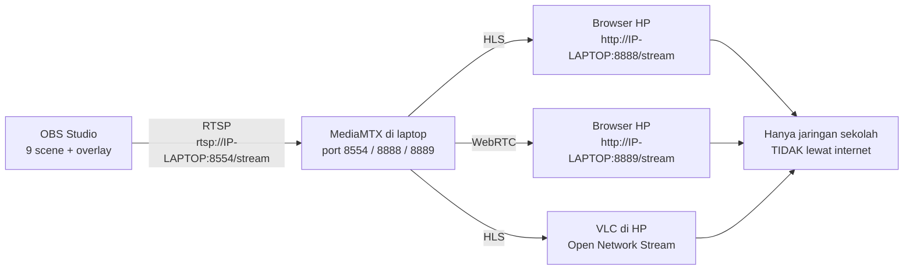

# LOCAL_STREAMING.md — Streaming Lokal Sekolah (Mode B: MediaMTX)

Mode B membuat tayangan pertandingan bisa ditonton **hanya di dalam jaringan sekolah (LAN/Wi-Fi sekolah)** — tanpa internet, tanpa YouTube. MediaMTX dipasang di laptop produksi dan menerima video RTSP dari OBS, lalu menyajikannya ke HP lain di Wi-Fi sekolah lewat browser atau VLC.

> **Peringatan penting (WAJIB dibaca):**
> 1. **Jangan membuka/meneruskan port di router tanpa izin admin jaringan sekolah.** Semua pengaturan di dokumen ini hanya di tingkat laptop.
> 2. **Jangan mengklaim streaming ini bisa ditonton dari internet.** MediaMTX lokal hanya dapat diakses perangkat yang terhubung ke jaringan sekolah yang sama. Untuk penonton luar, gunakan Mode A (YouTube Live).

---

## 1. Apa yang Dibutuhkan

- Laptop produksi (yang menjalankan OBS) — inilah "server".
- HP/laptop penonton yang terhubung **Wi-Fi/LAN sekolah yang sama**.
- File MediaMTX (gratis, satu file program, tidak perlu install penuh).
- Jaringan sekolah yang mengizinkan komunikasi antar perangkat (client isolation harus NONAKTIF — ditangani admin jaringan).

---

## 2. Install MediaMTX

### Windows
1. Unduh MediaMTX: `https://github.com/bluenviron/mediamtx/releases` → pilih `mediamtx_vX.X.X_windows_amd64.zip`.
2. Ekstrak ke folder, misalnya `C:\mediamtx`. Isinya: `mediamtx.exe` dan `mediamtx.yml`.
3. Tidak ada installer — program berjalan langsung dari file tersebut.

### Linux
1. Unduh rilis `linux_amd64.tar.gz` dari halaman releases.
2. Ekstrak:

```bash
tar -xzf mediamtx_vX.X.X_linux_amd64.tar.gz
```

3. Hasil ekstraksi: biner `mediamtx` dan file `mediamtx.yml`.

📸 [Tempel screenshot: folder MediaMTX yang berisi mediamtx.exe dan mediamtx.yml]

---

## 3. Konfigurasi rtsp → hls/webrtc

Buka `mediamtx.yml` dengan text editor. Bagian penting (nilai bawaan umumnya sudah benar):

| Pengaturan | Nilai | Arti |
|---|---|---|
| `rtspAddress` | `:8554` | Port RTSP untuk OBS mem-publish |
| `rtmpAddress` | `:1935` | (opsional) RTMP |
| `hlsAddress` | `:8888` | Port HLS untuk penonton via browser |
| `webrtcAddress` | `:8889` | Port WebRTC (latency terendah via browser) |
| `paths:` | `stream:` (path default `stream`) | Nama jalur stream |

Pastikan baris berikut aktif (tanpa tanda `#`):

```yaml
hlsAddress: :8888
webrtcAddress: :8889
```

Ciri kerja: **OBS mengirim RTSP ke `rtsp://IP-LAPTOP:8554/stream`**, MediaMTX mengubahnya menjadi HLS/WebRTC yang bisa dibuka browser HP. WebRTC memberi delay paling kecil (beberapa detik), HLS sedikit lebih besar tapi paling kompatibel.

---

## 4. Cari IP Laptop

1. Buka terminal/CMD:
   - Windows: `ipconfig` → catat **IPv4 Address** pada adapter Wi-Fi (misalnya `192.168.1.10`).
   - Linux: `ip addr` → cari `inet` pada interface Wi-Fi.
2. **IP ini akan menjadi alamat server** untuk penonton: `http://192.168.1.10:8888/stream`.
3. Agar IP tidak berubah, minta admin jaringan sekolah membuat **IP statis/DHCP reservation** untuk laptop ini (lihat bagian troubleshooting).

---

## 5. Jalankan MediaMTX

```bash
# Windows: klik dua kali mediamtx.exe, atau di CMD:
cd C:\mediamtx
mediamtx.exe

# Linux:
./mediamtx
```

Jendela akan menampilkan log. Biarkan jendela ini **tetap terbuka** selama pertandingan. Kuncinya: tunggu log menunjukkan server siap (baris berisi alamat `:8554`, `:8888`, `:8889` berjalan).

---

## 6. OBS Publish RTSP ke MediaMTX

1. Buka **Settings → Stream**.
2. Service: **Custom...**
3. Server: `rtsp://127.0.0.1:8554` (jika OBS dan MediaMTX di laptop yang sama; boleh juga pakai `rtsp://IP-LAPTOP:8554`)
4. Stream Key: `stream` (nama path pada `mediamtx.yml`).
5. Apply → OK.
6. Klik **Start Streaming** di OBS. Log MediaMTX akan menampilkan bahwa stream diterima pada path `stream`.
7. Video pertama butuh beberapa detik untuk tersedia di HLS/WebRTC.

> Catatan: RTSP custom di OBS mengirim stream tanpa kualitas YouTube (temuan umum: gunakan encoder settings di [OBS_SETUP.md](OBS_SETUP.md); bitrate 2500–5000 Kbps pas untuk LAN).

---

## 7. Cara HP Lain di LAN Menonton

1. Hubungkan HP penonton ke **Wi-Fi sekolah yang sama** dengan laptop.
2. Buka **browser** (Chrome):
   - HLS: `http://IP-LAPTOP:8888/stream` → halaman pemutar MediaMTX tampil.
   - WebRTC (delay terkecil): `http://IP-LAPTOP:8889/stream`.
3. Alternatif **VLC** (Android): Media → Open Network Stream → isi `http://IP-LAPTOP:8888/stream` → Play.
4. Spesifikasi alur lengkap: `rtsp://IP-LAPTOP:8554/stream` (dipakai OBS) → dilihat penonton via browser/VLC di HP sekolah pada port 8888/8889.
5. Tes sebelum hari-H: minta 2–3 HP uji menonton bersamaan.

---

## 8. Diagram Alur



---

## 9. Troubleshooting Jaringan

| Masalah | Penyebab | Solusi |
|---|---|---|
| HP tidak bisa membuka `http://IP-LAPTOP:8888/stream` | **Firewall laptop memblokir** port 8554/8888/8889 | Windows: Settings → Firewall → Allow an app → izinkan `mediamtx.exe` (Private network). Linux: sesuaikan `ufw`/`firewalld` **dengan izin admin jaringan sekolah** |
| HP tidak bisa membuka padahal firewall sudah longgar | **HP dan laptop beda jaringan/beda subnet** (mis. laptop di 192.168.1.x, HP di 192.168.43.x = hotspot) | Pastikan keduanya **satu Wi-Fi/LAN sekolah**, bukan hotspot pribadi |
| Bisa buka halaman tapi video macet | Client isolation Wi-Fi aktif, atau Wi-Fi penuh | Minta admin jaringan menonaktifkan AP isolation; kurangi jumlah perangkat |
| IP laptop berubah tiap hari | DHCP biasa | Minta **IP statis/DHCP reservation** pada laptop server (admin jaringan) |
| Semua normal kemarin, gagal hari ini | Laptop pindah hotspot, MediaMTX belum dijalankan, OBS belum Start Streaming | Jalankan urutan: MediaMTX → OBS Start Streaming → tes HP |

**Larangan:** jangan konfigurasi port forwarding/modem/router sendiri tanpa izin admin jaringan sekolah, dan jangan menaruh MediaMTX di VPS/internet — skenario resmi BOF Mode B adalah **LAN sekolah saja**.

---

## 10. Checklist Akhir Mode B

- [ ] MediaMTX terpasang dan berjalan (jendela log tetap terbuka).
- [ ] OBS Stream = Custom, `rtsp://127.0.0.1:8554`, key `stream`, Start Streaming sukses.
- [ ] IP laptop dicatat, idealnya IP statis (izin admin jaringan).
- [ ] Minimal 2 HP uji berhasil menonton `http://IP-LAPTOP:8888/stream` di Wi-Fi sekolah.
- [ ] Tidak ada port router yang dibuka tanpa izin; tidak ada klaim "bisa ditonton dari internet".

Panduan operator harian: [guides/GUIDE_11](guides/GUIDE_11_streaming-lokal-sekolah.md) dan [guides/GUIDE_15](guides/GUIDE_15_lihat-pertandingan-via-hp.md).
