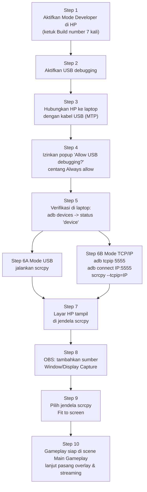

# MIRRORING_SETUP.md — Mirroring HP ke Laptop dengan scrcpy

Dokumen ini memandu menampilkan **layar HP Free Fire** ke layar laptop menggunakan **scrcpy**, lalu memasukkannya ke OBS. Mirroring bisa lewat **kabel USB** (paling stabil) atau **Wi-Fi/TCP-IP** (tanpa kabel).

---

## 1. Aktifkan Mode Developer & USB Debugging di HP

1. Buka **Settings → About phone** (Tentang ponsel).
2. Cari **Build number** (Nomor bentukan). Di beberapa HP: Settings → About phone → Software information.
3. **Ketuk Build number 7 kali** sampai muncul pesan "You are now a developer" / "Anda sekarang pengembang".
4. Kembali ke **Settings → System → Developer options** (Opsi pengembang). Lokasi menu berbeda antar merek (Xiaomi: Settings → Additional settings; Samsung: Settings → Developer options).
5. Aktifkan (ON) **USB debugging**.
6. Saat HP terhubung pertama kali ke laptop, akan muncul popup **"Allow USB debugging?"** di layar HP → centang "Always allow from this computer" → **Allow/Izinkan**.

📸 [Tempel screenshot: menu Developer options dengan USB debugging aktif]

---

## 2. Install scrcpy di Laptop

1. Unduh scrcpy dari `https://github.com/Genymobile/scrcpy/releases` (pilih rilis terbaru, file Windows `.zip` atau installer; Linux tersedia lewat package manager).
2. Ekstrak ke folder tetap, misalnya `C:\scrcpy`.
3. scrcpy sudah termasuk **adb** (alat komunikasi Android) di dalamnya — tidak perlu install terpisah.
4. Opsional: tambahkan folder scrcpy ke PATH agar bisa dipanggil dari terminal di folder mana pun.

---

## 3. Mode USB (Direkomendasikan untuk Pertandingan)

1. Hubungkan HP ke laptop dengan **kabel USB berkualitas baik** (kabel yang bisa transfer data, bukan kabel charger murah).
2. Pilih mode koneksi USB di HP = **File transfer / MTP** (bukan "charging only").
3. Izinkan popup USB debugging di HP (langkah 1.6).
4. Buka terminal/CMD di folder scrcpy, cek koneksi:

```bash
adb devices
```

Hasil yang benar: satu baris berisi nomor seri HP dan kata `device`. Jika tertulis `unauthorized` → izinkan popup di HP. Jika daftar kosong → cek kabel/port (lihat TROUBLESHOOTING.md).

5. Jalankan mirroring:

```bash
scrcpy
```

Layar HP akan muncul sebagai jendela di laptop dalam 1–2 detik.

6. Untuk kualitas/latency terbaik saat match, jalankan dengan opsi:

```bash
scrcpy --max-size 1080 --video-bit-rate 4M --max-fps 30
```

---

## 4. Mode TCP/IP (Tanpa Kabel, Via Wi-Fi)

Pakai hanya jika Wi-Fi/LAN sekolah stabil. Kualitas tidak sebaik USB.

1. Pertama kali tetap sambungkan HP dengan **kabel USB** sekali.
2. Pastikan **HP dan laptop terhubung ke jaringan Wi-Fi yang sama**.
3. Cek alamat IP HP: Settings → Wi-Fi → detail jaringan → tulis IP, misalnya `192.168.1.34`. Atau jalankan:

```bash
adb shell ip route
```

4. Alihkan adb ke mode jaringan pada port 5555 (saat masih terhubung USB):

```bash
adb tcpip 5555
```

5. Cabut kabel USB, lalu hubungkan lewat jaringan:

```bash
adb connect 192.168.1.34:5555
scrcpy --tcpip=192.168.1.34:5555
```

(Ganti `192.168.1.34` dengan IP HP Anda.)

6. Verifikasi: `adb devices` harus menampilkan `192.168.1.34:5555  device`.

**Catatan latency:** koneksi TCP-IP menambah sedikit jeda (biasanya masih layak untuk tayangan). Untuk game penting/klasemen penentu, gunakan USB. Kurangi latency: gunakan opsi `--video-bit-rate 4M`, hindari jarak Wi-Fi jauh, dekatkan HP ke router, dan pastikan tidak ada orang lain yang menonton video berat di Wi-Fi yang sama.

---

## 5. Audio Forwarding (Opsional)

scrcpy modern dapat meneruskan **suara HP ke laptop**:

```bash
scrcpy --audio-codec=opus
```

atau cukup `scrcpy` (audio forwarding aktif secara default pada HP Android 11+). Jika HP Android di bawah 11, suara HP tidak dapat diteruskan — gunakan pengaturan audio OBS (Audio Output Capture) atau set speaker HP cukup keras dan biarkan mikrofon/loopback menangkapnya, atau mainkan tanpa perlu audio dari HP. Lihat [OBS_SETUP.md](OBS_SETUP.md) bagian audio.

---

## 6. Masukkan ke OBS

1. Pastikan **OBS Studio** terpasang dan 9 scene sudah dibuat ([OBS_SETUP.md](OBS_SETUP.md)).
2. Pilih scene **Main Gameplay**.
3. Panel Sources → **+** → pilih **Window Capture**.
4. Pada dropdown Window, pilih jendela **scrcpy**.
5. Klik kanan sumber → **Transform → Fit to screen** agar layar HP penuh di canvas.
6. Alternatif: **Display Capture** jika scrcpy berjalan fullscreen atau ingin menangkap seluruh layar laptop.
7. Atur **crop** bila perlu (Alt + tarik tepi sumber) untuk membuang tepi jendela.

Hasil akhir: layar Free Fire dari HP tampil di OBS, siap ditambah overlay (lihat guides/GUIDE_09).

---

## 7. FLOWCHART Mirroring 10 Langkah



---

## 8. Checklist Akhir Mirroring

- [ ] USB debugging aktif, popup izin sudah diset "Always allow".
- [ ] `adb devices` menampilkan status `device`.
- [ ] scrcpy menampilkan layar HP lancar (uji 5 menit sambil main).
- [ ] Mode TCP/IP diuji cadangan (jika dipakai).
- [ ] OBS Window Capture menampilkan jendela scrcpy, Fit to screen.
- [ ] Kabel USB cadangan tersedia (kabel adalah komponen paling sering rusak).

Masalah umum: lihat [TROUBLESHOOTING.md](TROUBLESHOOTING.md) bagian "scrcpy gagal" dan [guides/GUIDE_07](guides/GUIDE_07_memakai-scrcpy.md).
