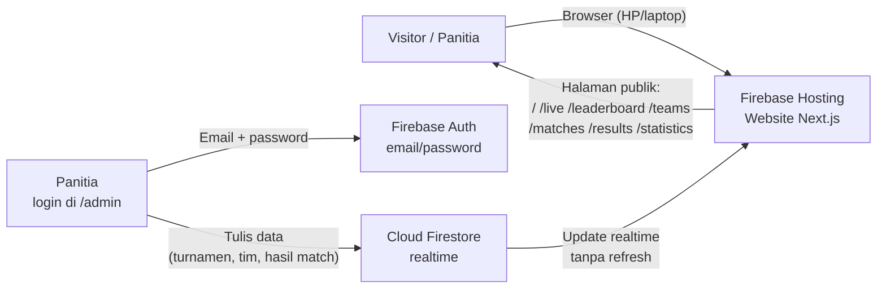
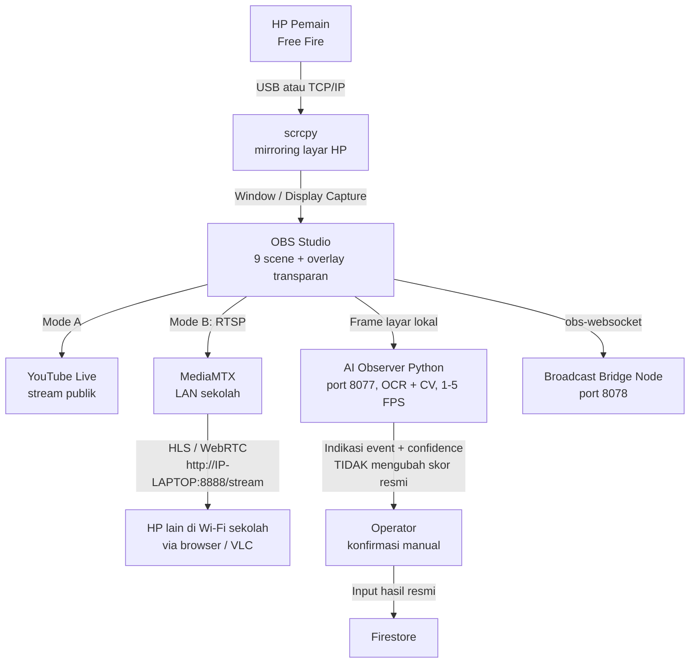

# STIKAR ESPORTS — BATTLE OFF FRIENDS (BOF)

Dokumentasi resmi platform **turnamen esports Free Fire** untuk **SMK TI BALI GLOBAL KARANGASEM**.

**Developer:** SAPUTRA DEVELOPER

Dokumen ini adalah pintu masuk utama seluruh dokumentasi. Semua materi ditulis dalam Bahasa Indonesia yang jelas dan langkah demi langkah, ditujukan untuk operator sekolah yang **tidak berlatar belakang teknis**. Ikuti dokumen secara berurutan pada bagian Quick Start.

---

## 1. Ringkasan Proyek

STIKAR ESPORTS — BATTLE OFF FRIENDS (BOF) adalah sistem penyelenggaraan turnamen Free Fire antar kelas/jurusan di lingkungan sekolah. Sistem terdiri dari:

| Komponen | Fungsi |
|---|---|
| **Website turnamen** | Menampilkan jadwal, tim, hasil match, leaderboard, statistik, dan halaman live. Realtime (perubahan skor langsung tampil tanpa refresh). |
| **Admin Panel** | Panel panitia di route `/admin` untuk mengelola turnamen, tim, match, dan hasil. Login memakai Firebase Auth email/password. |
| **Overlay OBS** | Lapisan grafis transparan (leaderboard, top 3, info match, lower third) yang dipasang di atas gameplay di OBS Studio. |
| **Mirroring HP** | Layar HP pemain Free Fire ditampilkan di laptop memakai **scrcpy** (kabel USB atau Wi-Fi/TCP-IP). |
| **Streaming Mode A** | Broadcast publik ke **YouTube Live** langsung dari OBS Studio. |
| **Streaming Mode B** | Broadcast **lokal dalam jaringan sekolah (LAN)** memakai **MediaMTX** — hanya bisa dilihat perangkat yang terhubung Wi-Fi/LAN sekolah, tidak lewat internet. |
| **AI Observer (lokal)** | Program Python di laptop yang membaca layar permainan (OCR + computer vision) untuk memberi **indikasi event** (misalnya indikasi kill) beserta tingkat keyakinan (confidence). Hasilnya hanya indikasi — skor resmi tetap dikonfirmasi manual oleh operator. Berjalan di port **8077**. Frame tidak diunggah ke internet. |
| **Broadcast Bridge (lokal)** | Layanan Node.js lokal di port **8078** yang menjembatani OBS Studio (via obs-websocket) dengan website. |

**Batasan penting:** infrastruktur memakai **Firebase Spark plan** (gratis, tanpa billing): Firebase Auth email/password + Cloud Firestore realtime, **tanpa Cloud Functions**. Jangan mengaktifkan billing atau fitur berbayar.

### Spesifikasi inti

- **Kapasitas default:** 12 tim per turnamen.
- **Format pertandingan:** Best of 3 (BO3), Best of 5 (BO5), Best of 7 (BO7), atau Custom.
- **Overlay dimensi didukung:** 1920×1080, 1600×900, 1280×720. Overlay transparan dan tanpa navbar/footer.

---

## 2. Sistem Poin BOF RESMI

Poin per match = **poin placement + poin kill**.

| Placement | Poin Placement | | Kill | Poin Kill |
|---|---|---|---|---|
| 1 | 20 | | 1 kill | 2 |
| 2 | 17 | | 2 kill | 4 |
| 3 | 15 | | 3 kill | 6 |
| 4 | 13 | | 4 kill | 8 |
| 5 | 12 | | 5 kill | 10 |
| 6 | 10 | | 6 kill | 12 |
| 7 | 6 | | 7 kill | 14 |
| 8 | 4 | | 8 kill | 16 |
| 9 | 3 | | 9 kill | 18 |
| 10 | 2 | | 10 kill | 20 |
| 11 | 1 | | 11 kill | 22 |
| 12 | 0 | | 12 kill | 24 |

> **Catatan:** aturan kill selalu **2 poin per kill**. Contoh: 8 kill = 8 × 2 = 16 poin.

**Total match = placement + kill.**
**Poin turnamen = jumlah poin dari seluruh match yang sudah dipublikasikan.** Match yang belum dipublikasikan tidak dihitung.

**Tiebreaker (jika poin sama):**
1. Total poin lebih tinggi menang.
2. Jika masih sama, bandingkan **placement points**.
3. Jika masih sama, bandingkan **placement di game terakhir sesuai format** (BO7 → lihat game 7; BO5 → game 5; dst.).
4. Jika masih sama → **review manual oleh panitia**.

Contoh resmi:
- **TEAM ALPHA** finish 1st + 8 kill → 20 + (8 × 2) = **36 poin**.
- **TEAM BRAVO** finish 2nd + 5 kill → 17 + (5 × 2) = **27 poin**.

Penjelasan lengkap: [guides/GUIDE_03](guides/GUIDE_03_sistem-poin-bof.md) (lihat daftar guide di `guides/README.md`).

---

## 3. Arsitektur

### 3.1 Alur Website (Visitor ke Data)



- Visitor membuka website (Firebase Hosting) dan membaca data langsung dari Firestore secara realtime.
- Panitia login di `/admin` memakai email/password (Firebase Auth), lalu menulis data turnamen/tim/match/hasil ke Firestore.
- Firestore menyebar pembaruan ke semua pengunjung seketika.

### 3.2 Alur Laptop Produksi (Hari Pertandingan)



Poin penting arsitektur produksi:
1. Gameplay berasal dari **layar HP yang dimirror** ke laptop (scrcpy), bukan dari emulator.
2. OBS Studio menggabungkan gameplay + overlay transparan menjadi satu keluaran.
3. Keluaran OBS dikirim ke **YouTube Live (Mode A)** atau **MediaMTX LAN (Mode B)** — pilih salah satu sesuai kebutuhan sekolah.
4. AI Observer bekerja **lokal di laptop**, hanya memberi indikasi event; skor resmi selalu dikonfirmasi manual operator lalu diinput ke website.
5. Broadcast Bridge menghubungkan OBS (obs-websocket) dengan website lewat port 8078.

---

## 4. Route Website (Referensi Cepat)

| Route | Fungsi |
|---|---|
| `/` | Beranda |
| `/live` | Daftar live |
| `/live/:tournamentId` | Live per turnamen |
| `/leaderboard` | Daftar leaderboard |
| `/leaderboard/:tournamentId` | Leaderboard per turnamen |
| `/teams` | Daftar tim |
| `/teams/:teamId` | Detail tim |
| `/matches` | Daftar match |
| `/matches/:matchId` | Detail match |
| `/results` | Hasil pertandingan |
| `/statistics` | Statistik |
| `/about` | Tentang |
| `/guide` | Panduan di website |
| `/guide/obs` | Panduan OBS di website |
| `/guide/mirroring` | Panduan mirroring di website |
| `/guide/streaming` | Panduan streaming di website |
| `/admin` | Admin Panel (login Firebase Auth) |

**Overlay (dipakai di OBS Browser Source):**

| Route Overlay | Isi |
|---|---|
| `/overlay/:tournamentId/full` | Leaderboard penuh |
| `/overlay/:tournamentId/compact` | Leaderboard ringkas |
| `/overlay/:tournamentId/top3` | Peringkat 3 teratas |
| `/overlay/:tournamentId/match-info` | Info match berjalan |
| `/overlay/:tournamentId/lower-third` | Lower third (nama/titel di bawah layar) |

Overlay mendukung dimensi 1920×1080, 1600×900, 1280×720, transparan, tanpa navbar/footer. Jika overlay tampak berlatar hitam, tambahkan `?transparent=1` pada URL (lihat `TROUBLESHOOTING.md`).

---

## 5. Quick Start (Urutan Pemasangan)

Ikuti dokumen berikut **berurutan**:

1. **[FIREBASE_SETUP.md](FIREBASE_SETUP.md)** — buat project Firebase (Spark plan, tanpa billing), aktifkan Auth email/password, buat Firestore, deploy rules & indexes, jalankan seeding, bootstrap super admin, deploy hosting.
2. **[OBS_SETUP.md](OBS_SETUP.md)** — install OBS Studio, buat 9 scene resmi, pasang overlay sebagai Browser Source, pasang obs-websocket.
3. **[MIRRORING_SETUP.md](MIRRORING_SETUP.md)** — aktifkan USB debugging di HP, jalankan scrcpy (USB atau TCP/IP), tampilkan gameplay ke OBS.
4. Pilih mode streaming:
   - **[YOUTUBE_SETUP.md](YOUTUBE_SETUP.md)** — Mode A, stream publik ke YouTube Live.
   - **[LOCAL_STREAMING.md](LOCAL_STREAMING.md)** — Mode B, stream lokal LAN sekolah via MediaMTX.
5. **[AI_OBSERVER_SETUP.md](AI_OBSERVER_SETUP.md)** — (opsional) jalankan AI Observer lokal, kalibrasi HUD, hubungkan dari Admin > AI Observer (`http://127.0.0.1:8077`).
6. **[TROUBLESHOOTING.md](TROUBLESHOOTING.md)** — buka saat ada masalah; berisi tabel masalah → penyebab → solusi.
7. **[guides/README.md](guides/README.md)** — 17 guide operasional harian (membuat turnamen, input hasil, memakai scrcpy, mengganti scene, dst).

Panduan ringkas juga tersedia di website pada route `/guide`, `/guide/obs`, `/guide/mirroring`, dan `/guide/streaming`.

---

## 6. Struktur Folder

Folder `documentation/` berisi:

```
documentation/
├── README.md                  → Ringkasan, arsitektur, quick start (file ini)
├── FIREBASE_SETUP.md          → Setup Firebase end-to-end
├── OBS_SETUP.md               → Setup OBS Studio + overlay + obs-websocket
├── MIRRORING_SETUP.md         → Setup scrcpy + USB debugging + capture ke OBS
├── LOCAL_STREAMING.md         → Setup MediaMTX untuk streaming LAN sekolah
├── YOUTUBE_SETUP.md           → Setup YouTube Live untuk stream publik
├── AI_OBSERVER_SETUP.md       → Setup AI Observer Python lokal (port 8077)
├── TROUBLESHOOTING.md         → Tabel masalah → penyebab → solusi
└── guides/
    ├── README.md              → Indeks 17 guide
    ├── GUIDE_01_membuat-turnamen.md
    ├── GUIDE_02_menambahkan-peserta-tim.md
    ├── GUIDE_03_sistem-poin-bof.md
    ├── GUIDE_04_memasukkan-hasil-pertandingan.md
    ├── GUIDE_05_mengedit-leaderboard.md
    ├── GUIDE_06_menghubungkan-hp-ke-laptop.md
    ├── GUIDE_07_memakai-scrcpy.md
    ├── GUIDE_08_gameplay-ke-obs.md
    ├── GUIDE_09_pasang-overlay-di-obs.md
    ├── GUIDE_10_streaming-publik.md
    ├── GUIDE_11_streaming-lokal-sekolah.md
    ├── GUIDE_12_jalankan-ai-observer.md
    ├── GUIDE_13_baca-hasil-analisis-ai.md
    ├── GUIDE_14_ganti-scene-obs.md
    ├── GUIDE_15_lihat-pertandingan-via-hp.md
    ├── GUIDE_16_atasi-masalah-video-leaderboard.md
    └── GUIDE_17_atasi-ai-gagal-baca-hud.md
```

Di luar folder dokumentasi, proyek juga memiliki bagian aplikasi web (Next.js), folder `scripts` (termasuk perintah seeding `npm run seed`), program AI Observer Python (port 8077), dan Broadcast Bridge Node (port 8078). Folder-folder tersebut **tidak dijelaskan di sini** — dokumentasi ini fokus pada panduan operasional di folder `documentation/`.

---

## 7. Prinsip Penting untuk Operator

1. **Jujur pada data.** Skor resmi hanya dari konfirmasi manual operator, bukan dari AI Observer. AI hanya memberi indikasi.
2. **Publikasi dulu baru dihitung.** Poin turnamen hanya dihitung dari match yang sudah dipublikasikan.
3. **Jangan bagikan stream key YouTube** kepada siapa pun.
4. **Jangan buka port router/firewall tanpa izin admin jaringan sekolah**, dan jangan mengklaim streaming lokal bisa ditonton dari internet — streaming MediaMTX hanya untuk jaringan sekolah.
5. **Simpan bukti.** Screenshot hasil match dan leaderboard sebelum mempublikasikan.

---

*Dokumentasi ini ditulis oleh SAPUTRA DEVELOPER untuk SMK TI BALI GLOBAL KARANGASEM. Terakhir disesuaikan dengan spesifikasi BOF resmi (sistem poin, 9 scene OBS, 5 overlay, 17 guide).*
