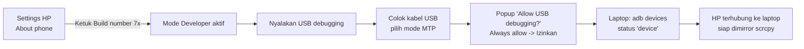

# GUIDE 06 — Cara Menghubungkan HP ke Laptop

## Tujuan
Membangun koneksi antara **HP Free Fire** dan **laptop produksi** sehingga layar HP bisa dimirror (langkah awal sebelum memakai scrcpy dan OBS).

## Prasyarat
- HP Android milik pemain (akun game sudah login).
- Kabel USB berkualitas data (bukan kabel charger murah).
- Laptop dengan scrcpy/adb terpasang ([MIRRORING_SETUP.md](../MIRRORING_SETUP.md)).

## Langkah-langkah
1. **Aktifkan Mode Developer di HP**: buka **Settings → About phone** → cari **Build number** → ketuk **7 kali** sampai muncul pesan "Anda sekarang pengembang".
2. Buka **Developer options** (lokasinya berbeda antar merek: Xiaomi ada di Additional settings; Samsung di System).
3. Aktifkan **USB debugging** (ON).
4. Hubungkan HP ke laptop dengan **kabel USB**.
5. Di HP, pilih mode koneksi USB = **File transfer / MTP** (bukan "Charging only").
6. Muncul popup **"Allow USB debugging?"** di layar HP → centang **"Always allow from this computer"** → tekan **Izinkan/Allow**.
7. Di laptop, buka terminal/CMD di folder scrcpy dan jalankan:

```bash
adb devices
```

8. Hasil benar: nomor seri HP diikuti kata **`device`**.
   - `unauthorized` → ulangi langkah 6 (izin belum diterima).
   - daftar kosong → cek kabel/port/driver (lihat [TROUBLESHOOTING.md](../TROUBLESHOOTING.md)).
9. Koneksi siap — lanjut menjalankan scrcpy ([GUIDE_07](GUIDE_07_memakai-scrcpy.md)).

## Diagram Alur



📸 [Tempel screenshot: popup "Allow USB debugging?" di HP dan hasil perintah adb devices di laptop]

## Tips
- Uji koneksi ini **sehari sebelum turnamen** dengan HP dan kabel yang persis akan dipakai hari-H.
- Sematkan kabel dengan selotip agar tidak tergelincir saat gameplay.
- Siapkan **kabel cadangan** — kabel rusak adalah penyebab nomor satu koneksi gagal.
- Jika satu HP dipakai bergantian beberapa pemain, izin "Always allow" cukup sekali.

## Kesalahan Umum
- Memakai kabel charger-only → laptop tidak melihat HP sama sekali.
- Menolak popup USB debugging → status `unauthorized`; ulangi dengan mencabut-pasang kabel.
- Mode USB dibiarkan "Charging only" → pilih MTP.
- USB debugging mati lagi setelah HP di-reset → cek Developer options setiap hari event.
- Menghubungkan lewat hub USB bermutu rendah → colok langsung ke laptop.
