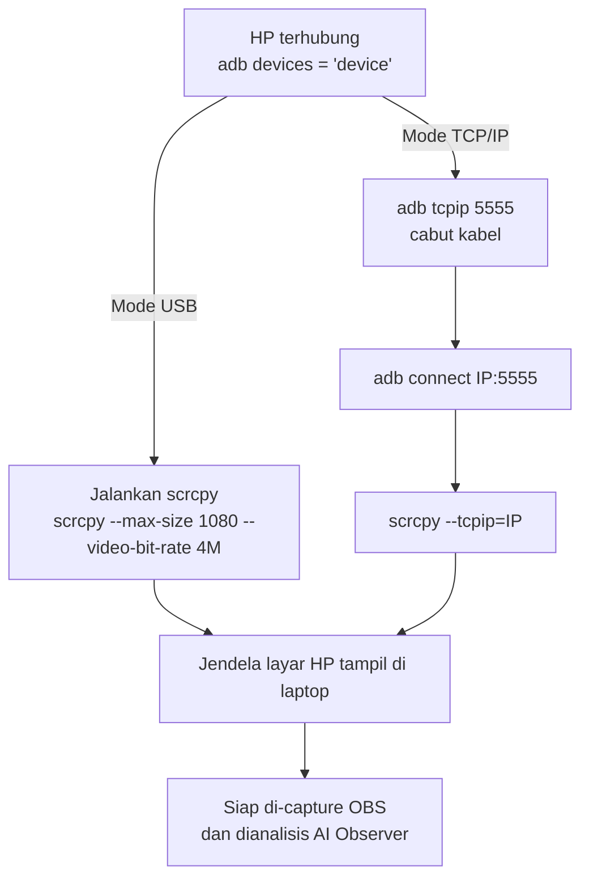

# GUIDE 07 — Cara Memakai scrcpy

## Tujuan
Menampilkan dan mengoperasikan layar HP Free Fire di laptop menggunakan **scrcpy** — dua mode: **USB** (paling stabil, rekomendasi hari-H) dan **TCP/IP** (tanpa kabel via Wi-Fi).

## Prasyarat
- USB debugging aktif dan HP terhubung (`adb devices` menampilkan `device`) — lihat [GUIDE_06](GUIDE_06_menghubungkan-hp-ke-laptop.md).
- scrcpy terpasang di laptop ([MIRRORING_SETUP.md](../MIRRORING_SETUP.md)).

## Langkah-langkah — Mode USB
1. Pastikan HP masih terhubung kabel USB dan `adb devices` menunjukkan status **`device`**.
2. Di folder scrcpy, jalankan:

```bash
scrcpy
```

3. Dalam 1–2 detik, jendela berisi **layar HP** muncul di laptop.
4. Untuk kualitas turnamen (resolusi/bitrate/fps terkendali, latency rendah):

```bash
scrcpy --max-size 1080 --video-bit-rate 4M --max-fps 30
```

5. Jendela scrcpy bisa dioperasikan dengan mouse/keyboard (touch → klik). Untuk menonton saja (pemain tetap main di HP), cukup biarkan jendela tampil tanpa disentuh.
6. **Jangan minimize jendela scrcpy** saat dipakai OBS/AI Observer — jendela harus terlihat di layar.

## Langkah-langkah — Mode TCP/IP (tanpa kabel)
1. Pertama kali: sambungkan HP dengan **kabel USB** dulu.
2. Pastikan **HP dan laptop di Wi-Fi yang sama**.
3. Cek IP HP: Settings → Wi-Fi → detail jaringan (misal `192.168.1.34`).
4. Saat masih terhubung kabel, jalankan:

```bash
adb tcpip 5555
```

5. Cabut kabel, lalu:

```bash
adb connect 192.168.1.34:5555
scrcpy --tcpip=192.168.1.34:5555
```

6. Layar HP tampil via Wi-Fi. Ingat: latency sedikit lebih tinggi dibanding USB — gunakan USB untuk match penentuan.

## Diagram Alur



📸 [Tempel screenshot: jendela scrcpy yang menampilkan layar Free Fire di laptop]

## Tips
- Ukuran jendela scrcpy bebas diubah — untuk OBS, tampilkan penuh pada satu area layar yang konsisten.
- Tutup aplikasi lain yang berat di laptop agar mirroring lancar.
- Tulis IP HP di label kertas jika memakai TCP/IP, supaya cepat reconnect.
- scrcpy gratis dan berjalan lokal — tidak ada data game yang dikirim ke internet; hanya laptop ↔ HP.

## Kesalahan Umum
- Menjalankan scrcpy sebelum mengizinkan USB debugging → error `unauthorized`.
- Memakai IP lama setelah HP ganti Wi-Fi → `adb connect` gagal; cek ulang IP.
- Minimize jendela scrcpy → Window Capture di OBS menjadi hitam dan AI Observer kehilangan frame.
- Menyalakan mode hemat daya ekstrem di HP → mirroring patah-patah; biarkan HP mencas lewat kabel (USB sekaligus mengisi baterai).
- Banyak perangkat di Wi-Fi menonton video saat TCP/IP → bandwidth terbagi, gambar turun kualitas.
