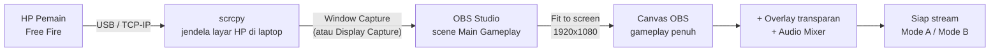

# GUIDE 08 — Cara Memasukkan Gameplay ke OBS

## Tujuan
Menampilkan gameplay Free Fire (yang sudah dimirror lewat scrcpy) ke dalam **scene Main Gameplay** di OBS Studio sehingga siap dipakai untuk overlay dan streaming.

## Prasyarat
- OBS Studio terpasang dan 9 scene resmi sudah dibuat ([OBS_SETUP.md](../OBS_SETUP.md)).
- scrcpy berjalan dan layar HP tampil di jendela laptop ([GUIDE_07](GUIDE_07_memakai-scrcpy.md)).

## Langkah-langkah
1. Buka **OBS Studio**. Pilih scene **Main Gameplay** (scene utama untuk match).
2. Pada panel **Sources**, klik **+**.
3. Pilih **Window Capture** (rekomendasi) — atau **Display Capture** bila scrcpy berjalan fullscreen.
4. Beri nama sumber, misalnya `Gameplay scrcpy`.
5. Pada dropdown **Window**, pilih jendela **scrcpy** → OK.
6. Layar HP kini tampil di canvas OBS. Klik kanan sumber → **Transform → Fit to screen** agar gameplay memenuhi canvas 1920×1080.
7. Jika ada tepi jendela/lembar hitam yang ikut tertangkap: tahan **Alt** lalu tarik tepi sumber untuk **crop**.
8. Uji: minta pemain masuk Free Fire — gerakan di HP harus mengikuti di canvas OBS tanpa hambatan berarti.
9. Cek **Audio Mixer**: pastikan suara game terbaca (tambahkan Audio Output Capture bila belum — lihat [OBS_SETUP.md](../OBS_SETUP.md) bagian audio).
10. Duplikat pengaturan ini ke scene **Gameplay + Compact Leaderboard** (scene 3) dengan menambahkan overlay compact di atasnya ([GUIDE_09](GUIDE_09_pasang-overlay-di-obs.md)).

## Diagram Alur

📸 [Tempel screenshot: panel Sources OBS dengan sumber Window Capture scrcpy yang terlihat di canvas]

## Tips
- Konsisten: **selalu gunakan Window Capture** pada hari-H (Display Capture membawa semua isi desktop — risiko bocor isi layar lain).
- Simpan urutan langkah ini di lembar operasional; jika laptop restart, pengulangannya hanya 2 menit.
- Untuk 12 tim bergantian, scrcpy hanya perlu **disambungkan ke HP pemain aktif**; capture OBS tidak perlu diubah asal jendela scrcpy sama.

## Kesalahan Umum
- Memilih jendela yang salah di dropdown Window (mis. terminal scrcpy, bukan jendela gambar).
- Lupa **Fit to screen** sehingga gameplay terpotong/kecil.
- Minimize jendela scrcpy → capture hitam (lihat [TROUBLESHOOTING.md](../TROUBLESHOOTING.md)).
- Menambahkan sumber ke scene yang salah (mis. ke Starting Soon) — selalu periksa scene aktif sebelum menambah sumber.
- Suara game tidak masuk karena hanya Window Capture (gambar saja) — tambahkan sumber audio terpisah.
