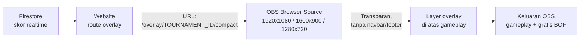

# GUIDE 09 — Cara Memasang Overlay STIKAR di OBS

## Tujuan
Memasang **overlay transparan** (leaderboard, top 3, info match, lower third) di atas gameplay dalam OBS, sehingga penonton melihat grafis skor BOF yang realtime.

## Prasyarat
- OBS Studio dengan scene siap ([GUIDE_08](GUIDE_08_gameplay-ke-obs.md)).
- Turnamen sudah dibuat dan `tournamentId` diketahui ([GUIDE_01](GUIDE_01_membuat-turnamen.md)).
- Website sudah online (Firebase Hosting) atau berjalan lokal di laptop.

## Langkah-langkah
1. Tentukan overlay yang dibutuhkan per scene:

| Scene | Overlay | URL |
|---|---|---|
| Gameplay + Compact Leaderboard | Leaderboard ringkas | `/overlay/TOURNAMENT_ID/compact` |
| Full Leaderboard | Leaderboard penuh | `/overlay/TOURNAMENT_ID/full` |
| Top 3 Ranking | Peringkat 3 teratas | `/overlay/TOURNAMENT_ID/top3` |
| Main Gameplay (opsional) | Info match | `/overlay/TOURNAMENT_ID/match-info` |
| Kapan pun perlu nama/titel | Lower third | `/overlay/TOURNAMENT_ID/lower-third` |

2. Ganti `TOURNAMENT_ID` dengan ID turnamen sungguhan (salin dari URL `/leaderboard/TOURNAMENT_ID`).
3. Di OBS, pilih scene tujuan → panel Sources → **+** → **Browser**.
4. Isi **URL** lengkap, contoh: `https://alamat-website-sekolah.web.app/overlay/TOURNAMENT_ID/compact`.
5. Isi **Width/Height** sesuai dimensi didukung: **1920×1080**, **1600×900**, atau **1280×720**. Samakan dengan canvas agar proporsi pas.
6. Centang **Refresh browser when scene becomes active** → OK.
7. Overlay muncul di atas gameplay — **transparan, tanpa navbar/footer**. Geser/atur posisi sesuai desain.
8. Jika overlay berlatar **hitam**: tambahkan `?transparent=1` di akhir URL (contoh `.../compact?transparent=1`) dan pastikan sumber tipe Browser — bukan gambar. Detail di [TROUBLESHOOTING.md](../TROUBLESHOOTING.md).
9. Uji realtime: ubah skor lewat `/admin` (match dipublikasikan) → data di overlay OBS harus ikut berubah tanpa restart OBS.
10. Ulangi untuk scene lain yang memakai overlay berbeda.

## Diagram Alur

📸 [Tempel screenshot: panel Browser Source di OBS dengan URL overlay compact yang tampil transparan di atas gameplay]

## Tips
- Buat semua overlay di **hari sebelum event** dan tes dengan turnamen asli (ID benar) — jangan menunggu hari-H.
- Overlay di-refresh otomatis tiap scene aktif; jika ada perubahan besar di website, klik kanan sumber → **Refresh** sekali.
- Jangan menutupi area HUD penting Free Fire dengan lower third.

## Kesalahan Umum
- Menyalin URL contoh dengan `TOURNAMENT_ID` belum diganti → overlay kosong.
- Overlay keluar navbar/footer karena membuka halaman biasa, bukan route `/overlay/...`.
- Latar hitam di OBS karena sumber dibuat sebagai Image/Media, bukan Browser.
- Dimensi tidak didukung (mis. 1440×810) — pakai 1920×1080, 1600×900, atau 1280×720.
- Memakai ID turnamen penyisihan untuk overlay final → data tampil tapi turnamen salah.
