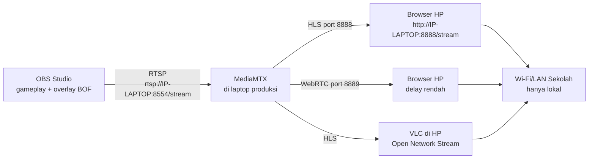

# GUIDE 11 — Cara Membuat Streaming Lokal Sekolah

## Tujuan
Membuat tayangan pertandingan yang bisa ditonton **HP-hp di Wi-Fi/LAN sekolah** menggunakan **MediaMTX (Mode B)** — tanpa internet dan tanpa YouTube.

> **Batas resmi Mode B:** tayangan hanya menjangkau perangkat di jaringan sekolah yang sama. **Tidak bisa ditonton dari internet** dan **jangan membuka port router tanpa izin admin jaringan sekolah**.

## Prasyarat
- MediaMTX terpasang di laptop ([LOCAL_STREAMING.md](../LOCAL_STREAMING.md)).
- OBS siap dengan gameplay + overlay ([GUIDE_08](GUIDE_08_gameplay-ke-obs.md)).
- IP laptop diketahui (mis. `192.168.1.10`), idealnya IP statis dari admin jaringan.

## Langkah-langkah
1. Jalankan **MediaMTX** di laptop (klik `mediamtx.exe` / `./mediamtx`). Biarkan jendela log tetap terbuka.
2. Pastikan log menunjukkan server aktif di port **8554** (RTSP), **8888** (HLS), **8889** (WebRTC).
3. Buka **OBS → Settings → Stream**:
   - Service: **Custom...**
   - Server: `rtsp://127.0.0.1:8554`
   - Stream Key: `stream`
4. Klik **Start Streaming** di OBS. Log MediaMTX menandai stream masuk ke path `stream`.
5. Cari IP laptop: `ipconfig` (Windows) / `ip addr` (Linux) → catat IPv4, misal `192.168.1.10`.
6. Di HP uji coba yang terhubung **Wi-Fi sekolah yang sama**, buka browser → `http://192.168.1.10:8888/stream` (HLS) atau `http://192.168.1.10:8889/stream` (WebRTC, delay paling kecil).
7. Alternatif **VLC**: Media → Open Network Stream → `http://192.168.1.10:8888/stream` → Play.
8. Coba dari **2–3 HP sekaligus** untuk menguji beban.
9. Gagal akses? Periksa firewall laptop (izinkan `mediamtx.exe`) dan pastikan HP tidak pakai hotspot pribadi — lihat [TROUBLESHOOTING.md](../TROUBLESHOOTING.md).
10. Hari-H: urutan hidup = MediaMTX → OBS Start Streaming → umumkan alamat `http://IP-LAPTOP:8888/stream` ke penonton di papan/WA kelas.

## Diagram Alur

📸 [Tempel screenshot: log MediaMTX saat OBS Start Streaming dan tampilan pemutar di browser HP]

## Tips
- Tempel tulisan besar `http://IP-LAPTOP:8888/stream` di layar venue dan grup WhatsApp kelas.
- WebRTC (port 8889) paling enak untuk menonton sambil bergerak; HLS paling kompatibel semua HP.
- Jika banyak penonton, minta admin jaringan memastikan Wi-Fi sekolah kuat dan tanpa AP isolation.
- Alur ini berjalan **paralel** dengan YouTube: OBS hanya bisa mengirim ke satu destination Stream Settings sekaligus — pilih Mode A atau Mode B per sesi, atau gunakan laptop kedua untuk mode kedua.

## Kesalahan Umum
- OBS belum **Start Streaming** → HP membuka halaman tapi video tidak jalan.
- HP penonton memakai **hotspot pribadi** → beda jaringan, tidak bisa akses.
- Firewall laptop memblokir MediaMTX → halaman tidak terbuka sama sekali.
- Menjanjikan "bisa ditonton dari rumah" — **salah**: Mode B hanya LAN sekolah; untuk luar gunakan Mode A.
- Membuka port router sendiri tanpa izin admin jaringan — **dilarang**.
- IP laptop berubah tiap sambung Wi-Fi → minta IP statis.
