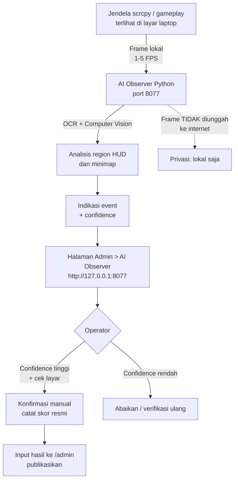

# GUIDE 12 — Cara Menjalankan AI Observer

## Tujuan
Mengoperasikan **AI Observer** (Python lokal, port **8077**) untuk mendapatkan **indikasi event** permainan yang membantu operator mencatat match lebih cepat. Skor resmi tetap dikonfirmasi manual.

## Prasyarat
- Python **3.10+** terpasang di laptop (`python --version`).
- Folder proyek AI Observer lengkap dengan `requirements.txt`.
- Gameplay tampil di laptop (scrcpy berjalan) — AI membaca frame lokal dari layar.

## Langkah-langkah
1. Buka terminal/CMD di folder proyek AI Observer.
2. Buat dan aktifkan **venv**:

```bash
python -m venv venv
venv\Scripts\activate        # Windows
# atau: source venv/bin/activate  (Linux)
```

3. Install dependensi:

```bash
pip install -r requirements.txt
```

4. Jalankan program AI Observer (perintah sesuai README folder proyek, umumnya `python main.py`). Layanan hidup di **`http://127.0.0.1:8077`**.
5. Uji: buka `http://127.0.0.1:8077` di browser laptop — halaman status AI harus tampil.
6. **Kalibrasi region HUD & minimap**: di menu kalibrasi, tarik kotak area pas di sekitar elemen HUD (angka alive/kill feed) dan minimap. Simpan. (Detail: [AI_OBSERVER_SETUP.md](../AI_OBSERVER_SETUP.md))
7. Pilih **FPS analisis**: mulai **1** FPS untuk tes, **2** FPS untuk hari-H, **5** FPS hanya jika laptop kuat.
8. Hubungkan ke website: login `/admin` → menu **AI Observer** → masukkan URL **`http://127.0.0.1:8077`** → hubungkan. Status harus "terhubung".
9. Jalankan game tes 5 menit; pastikan indikasi event muncul dengan confidence yang masuk akal.
10. Saat match resmi: biarkan AI berjalan, operator memantau indikasi dan **mengonfirmasi manual** setiap event ([GUIDE_13](GUIDE_13_baca-hasil-analisis-ai.md)).

## Diagram Alur



📸 [Tempel screenshot: halaman kalibrasi region HUD AI Observer dengan kotak area menempel pada angka HUD]

## Tips
- Kalibrasi **sekali per resolusi**; ulangi bila resolusi scrcpy/OBS berubah.
- Jangan tutup/minimize jendela gameplay — AI membaca frame yang tampak di layar.
- AI dan OBS di laptop yang sama bisa berat; mulai FPS 1–2 dan pantau suhu laptop.
- Fitur AI hanyalah **pembantu pencatatan**; tetap siapkan lembar penilaian manual.

## Kesalahan Umum
- Menjalankan `pip install` **tanpa mengaktifkan venv** → dependensi bercampur sistem.
- Memasukkan URL salah (mis. `https://` atau port lain) — gunakan `http://127.0.0.1:8077`.
- Menganggap output AI sebagai skor resmi — AI **tidak mengubah skor**; konfirmasi manual wajib.
- Mengubah konfigurasi agar frame dikirim ke luar — **melanggar prinsip privasi** (frame tetap lokal).
- Membuka banyak aplikasi berat → FPS analisis turun dan OCR meleset ([GUIDE_17](GUIDE_17_atasi-ai-gagal-baca-hud.md)).
