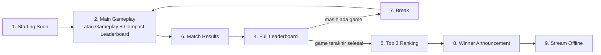

# GUIDE 14 — Cara Mengganti Scene OBS

## Tujuan
Mengoperasikan **9 scene resmi BOF** dengan urutan yang benar sepanjang acara — memakai hotkey supaya perpindahan cepat dan tidak salah klik saat siaran.

## Prasyarat
- OBS Studio dengan 9 scene dibuat persis ([OBS_SETUP.md](../OBS_SETUP.md)).
- Hotkey scene sudah diatur (contoh: F1–F9).

## Daftar Scene Resmi dan Momen Pemakaian

| No | Scene | Dipakai saat |
|---|---|---|
| 1 | **Starting Soon** | Countdown pembuka, sebelum game pertama |
| 2 | **Main Gameplay** | Match berjalan, gameplay penuh |
| 3 | **Gameplay + Compact Leaderboard** | Match berjalan + leaderboard kecil di sisi layar |
| 4 | **Full Leaderboard** | Jeda antar game, rekap peringkat penuh |
| 5 | **Top 3 Ranking** | Seremoni peringkat tiga besar |
| 6 | **Match Results** | Tepat setelah game selesai, menampilkan hasil |
| 7 | **Break** | Istirahat antar game |
| 8 | **Winner Announcement** | Pengumuman juara di akhir |
| 9 | **Stream Offline** | Setelah siaran ditutup |

## Langkah-langkah
1. Sebelum siaran, urutkan panel **Scenes** sesuai alur acara (drag untuk menyusun ulang).
2. Pastikan hotkey (Settings → Hotkeys) sudah terisi untuk semua scene — hindari mengganti scene dengan klik mouse saat siaran.
3. Saat acara:
   - 15 menit sebelum mulai → **Starting Soon**.
   - Masuk game → **Main Gameplay** (atau **Gameplay + Compact Leaderboard** bila ingin skor kecil tampil terus).
   - Game selesai → **Match Results** selama input hasil di `/admin` ([GUIDE_04](GUIDE_04_memasukkan-hasil-pertandingan.md)).
   - Input selesai & dipublikasikan → **Full Leaderboard** agar penonton melihat poin terbaru.
   - Istirahat → **Break**; apabila ada gangguan teknis mendadak, langsung lompat ke **Break**/Starting Soon supaya layar "aman".
   - Menjelang penutupan → **Top 3 Ranking** → **Winner Announcement**.
   - Akhir siaran → **Stream Offline**, lalu Stop Streaming.
4. Tekan **satu hotkey saja** per transisi; beri jeda 2–3 detik agar overlay sempat memuat (Browser Source refresh saat scene aktif).
5. Setelah OBS restart: cek semua scene tampil benar (scene aktif kembali refresh overlay otomatis).
6. Bila Broadcast Bridge (port 8078) aktif, pergantian scene juga bisa dipicu dari sisi website — pastikan obs-websocket dan token benar ([TROUBLESHOOTING.md](../TROUBLESHOOTING.md)).

## Alur Acara Standar

📸 [Tempel screenshot: panel Scenes di OBS dengan 9 scene berurutan dan pengaturan hotkeys]

## Tips
- Latihan transisi **satu kali penuh** saat gladi bersih — operator baru biasanya salah urutan di game pertama.
- Scene **Break** adalah tombol aman Anda: saat apa pun kacau (audio, mirroring, input skor), pindah ke Break dulu.
- Tulis run-down per game di kertas di samping keyboard.

## Kesalahan Umum
- Ganti scene dengan klik panel saat siaran → klik salah scene; pakai hotkey.
- Lupa kembali dari Break → penonton menonton layar jeda padahal game sudah jalan (komunikasi dengan komentator penting).
- Menuju Winner Announcement sebelum semua hasil dipublikasikan → leaderboard akhir salah tampil.
- Scene tidak refresh overlay → centang *Refresh browser when scene becomes active* pada Browser Source.
- Memakai scene dengan overlay turnamen lama — pastikan `TOURNAMENT_ID` di setiap overlay sesuai turnamen berjalan.
