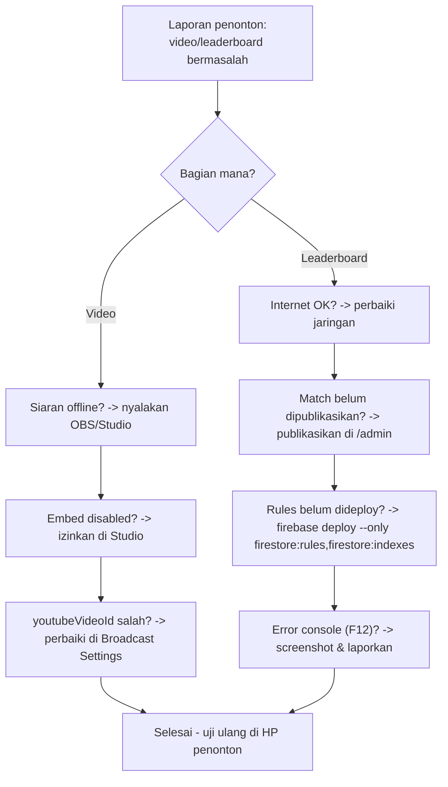

# GUIDE 16 — Cara Mengatasi Masalah Video dan Leaderboard

## Tujuan
Panduan cepat operator ketika **video di website tidak muncul** atau **leaderboard tidak ter-update** — dua masalah paling sering dilaporkan penonton.

## Prasyarat
- Akses `/admin` dan terminal laptop (untuk perintah Firebase bila perlu).
- Referensi lengkap: [TROUBLESHOOTING.md](../TROUBLESHOOTING.md).

## Bagian A — Video Tidak Muncul di Website
1. **Cek status siaran dulu.** Jika stream offline, memang tidak ada video. Pastikan OBS **Start Streaming** dan Studio menunjukkan LIVE.
2. **Cek izin embed.** YouTube Studio → siaran → pastikan embedding **diizinkan**. Kalau "embedding disabled", website tidak dapat menampilkan video walaupun siaran berjalan.
3. **Cek youtubeVideoId.** `/admin` → turnamen → **Broadcast Settings** → kolom `youtubeVideoId`. Harus berupa **video ID saja** (contoh `abc123XYz`), bukan URL penuh. Salin ulang dari URL YouTube bila ragu.
4. **Muat ulang halaman** `/live/:tournamentId` (hard refresh: tarik-turun di Chrome mobile / Ctrl+Shift+R di laptop).
5. Masih gagal? Coba buka tayangan langsung di YouTube — jika YouTube normal tapi website tidak, masalahnya di embed (kembali ke langkah 2–3).

## Bagian B — Leaderboard Tidak Update
1. **Cek internet perangkat** (buka situs lain). Jika internet mati, leaderboard memang tidak bergerak — perbaiki jaringan dulu.
2. **Cek apakah match sudah dipublikasikan.** Aturan BOF: **poin turnamen hanya dihitung dari match yang sudah dipublikasikan**. Jika data diinput tapi belum dipublikasikan, leaderboard sah untuk tidak berubah — publikasikan di `/admin` ([GUIDE_04](GUIDE_04_memasukkan-hasil-pertandingan.md)).
3. **Cek rules Firestore.** Jika semua perangkat gagal membaca data, kemungkinan rules belum dideploy. Dari folder proyek jalankan:

```bash
firebase deploy --only firestore:rules,firestore:indexes
```

4. **Cek console browser (laptop):** tekan **F12** → tab **Console** → cari pesan error (merah), misalnya `permission denied` (rules) atau `network error` (koneksi). Screenshot pesan untuk laporan developer.
5. **Cek env/config project**: pastikan website mengarah ke project Firebase yang benar.
6. Setelah perbaikan: refresh halaman; leaderboard realtime seharusnya hidup kembali tanpa refresh berulang.

## Diagram Keputusan Cepat



📸 [Tempel screenshot: tab Console (F12) browser menampilkan pesan error yang di-screenshot untuk laporan]

## Tips
- Tanggapi laporan penonton dengan kalimat tenang: "Tim panitia sedang memeriksa, skor resmi tetap dicatat manual" — pencatatan kertas berjalan terpisah dari website.
- Screenshot **sebelum** mengubah apa pun, sebagai bukti laporan.

## Kesalahan Umum
- Menyalahkan website padahal **match belum dipublikasikan** — ini perilaku normal sistem BOF.
- Menyalin URL lengkap YouTube ke kolom `youtubeVideoId` — cukup ID-nya.
- Deploy rules ke project salah (`firebase use` tidak diarahkan) — cek `firebase use --add`.
- Mengubah skor manual di database tanpa bukti — koreksi selalu lewat `/admin` ([GUIDE_05](GUIDE_05_mengedit-leaderboard.md)).
- Berhenti mencari di langkah pertama — ikuti urutan cek A/B sampai selesai.
