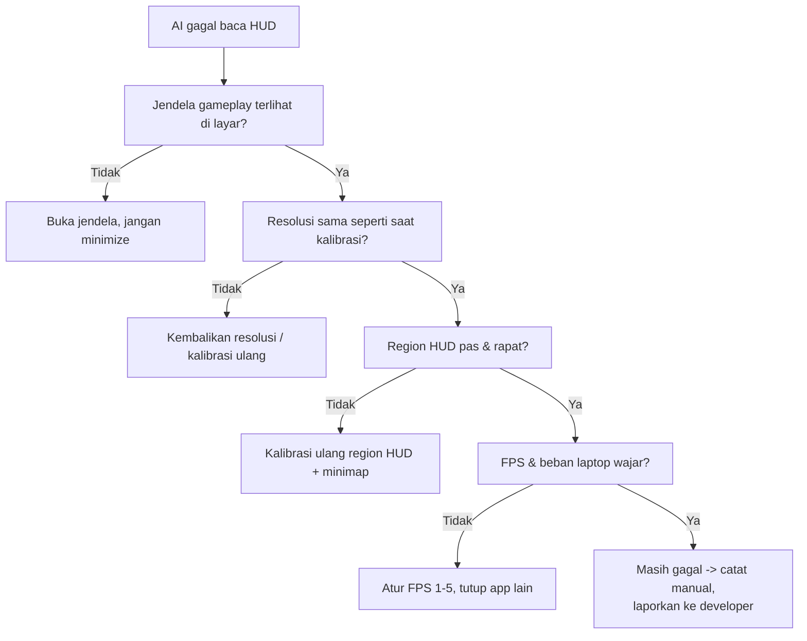

# GUIDE 17 — Cara Mengatasi AI Observer Gagal Membaca HUD

## Tujuan
Memulihkan kualitas pembacaan **AI Observer** ketika OCR/computer vision tidak mendeteksi HUD (angka alive/kill feed) atau minimap — penyebab umum: kalibrasi region bergeser, resolusi berubah, atau jendela gameplay tertutup.

## Prasyarat
- AI Observer terpasang dan berjalan di port **8077** ([GUIDE_12](GUIDE_12_jalankan-ai-observer.md)).
- Akses halaman Admin > AI Observer dan menu kalibrasi.
- Gameplay/scrcpy masih tampil di laptop.

## Langkah-langkah
1. **Identifikasi gejala** di Admin > AI Observer:
   - Hasil analisis kosong terus → AI tidak "melihat" apa pun.
   - Hasil ada tapi angka salah/kacau → OCR salah baca.
   - Indikasi telat jauh → FPS terlalu rendah/laptop berat.
2. **Pastikan frame tersedia.** Jendela scrcpy/gameplay harus **tampak di layar**: tidak di-minimize, tidak tertutup jendela lain, tidak di desktop lain. AI membaca frame lokal dari layar.
3. **Cek resolusi.** Jika resolusi scrcpy/layar/canvas OBS berubah setelah kalibrasi terakhir (mis. dulu 1920×1080, kini 1280×720), region HUD lama tidak cocok lagi. Kembalikan resolusi yang sama **atau** kalibrasi ulang pada resolusi baru. Resolusi overlay didukung: 1920×1080, 1600×900, 1280×720.
4. **Kalibrasi ulang region HUD & minimap:**
   - Buka menu kalibrasi AI Observer.
   - Tarik kotak region **pas dan rapat** di sekitar elemen: HUD atas/bawah (angka alive, kill feed) dan minimap pojok layar.
   - Terlalu lebar = ikut menangkap background → salah baca. Terlalu sempit = memotong angka → tidak terbaca.
   - Simpan, lalu jalankan game tes 2–5 menit.
5. **Sesuaikan FPS analisis** bila perlu: 1 FPS (laptop lemah) → 2 FPS (umum) → 5 FPS (laptop kuat). Naikkan jika indikasi telat; turunkan bila CPU max dan frame patah.
6. **Bersihkan beban laptop**: tutup aplikasi lain, hentikan rekaman yang tidak perlu; panas berlebih menurunkan kinerja OCR.
7. **Uji ulang hasil**: indikasi event dengan confidence wajar saat ada aktivitas nyata di game ([GUIDE_13](GUIDE_13_baca-hasil-analisis-ai.md)).
8. Jika tetap gagal total: **lanjutkan turnamen dengan pencatatan manual** — skor resmi TIDAK bergantung AI. Laporkan masalah + screenshot ke developer setelah acara.
9. Jaga jangan mengubah konfigurasi agar frame dikirim ke internet — analisis harus tetap lokal (privasi).

## Kesalahan Teknis yang Sering Ditemukan

📸 [Tempel screenshot: kotak kalibrasi region HUD yang salah posisi (contoh buruk) berdampingan dengan kalibrasi yang benar]

## Tips
- Simpan pengaturan kalibrasi per resolusi; saat ganti resolusi, tulis di lembar panitia agar operator tahu kapan kalibrasi ulang wajar.
- Tes kalibrasi **saat gladi bersih**, bukan 5 menit sebelum final.
- Ketika efek visual game (flash/kilatan) mengganggu OCR, itulah alasan confidence ada — baca [GUIDE_13](GUIDE_13_baca-hasil-analisis-ai.md) sebelum mengambil keputusan.

## Kesalahan Umum
- Mengkalibrasi pada **layar preview OBS**, padahal AI membaca frame sumber yang berbeda — kalibrasi pada frame yang benar-benar dianalisis.
- Region dibuat sekali dan **tidak pernah dicek ulang** saat resolusi berubah.
- Menyalahkan AI padahal jendela gameplay tertutup jendela OBS lain.
- Menaikkan FPS ke 5 pada laptop lemah → semuanya justru makin lambat.
- Mengira AI wajib sukses — AI adalah alat bantu indikasi; kegagalan baca normal dan pencatatan manual selalu jadi jalan resmi.
